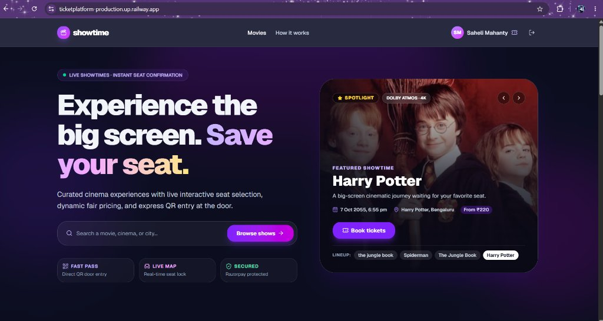
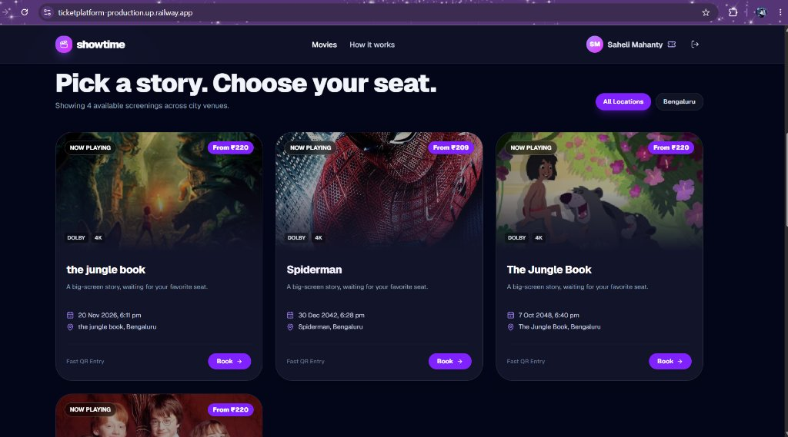
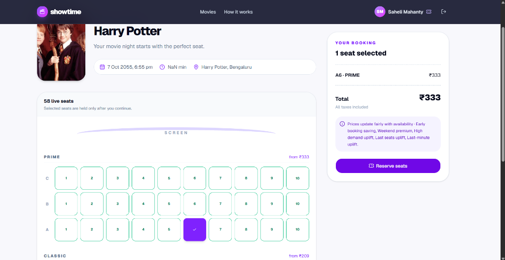
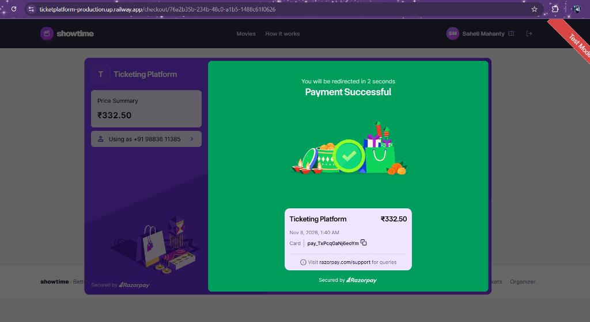
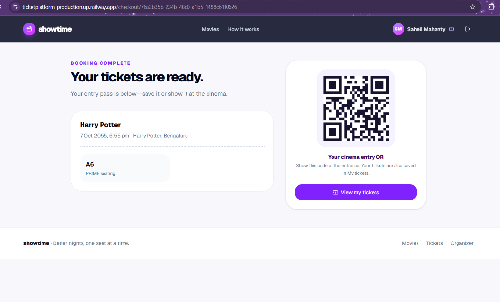

# Showtime — High-Concurrency Cinema Ticketing & Event Platform

[](https://ticketplatform-production.up.railway.app)
[](https://ticketplatform-production.up.railway.app)
[](https://nextjs.org/)
[](https://www.postgresql.org/)
[](https://www.rabbitmq.com/)

Showtime is a production-grade, distributed movie ticketing platform built to handle real-world backend concurrency, race-condition-free seat reservations, dynamic demand-driven pricing, and financial payment verification.

---

## 🚀 Live Demo & Demo Credentials

* **Live Production URL:** [https://ticketplatform-production.up.railway.app](https://ticketplatform-production.up.railway.app)
* **Demo Organizer / Admin Account:**
  * **Email:** `org@gmail.com`
  * **Password:** `12345678`
  * **Role:** `ADMIN` (Full organizer & admin authority)
* **What you can test with this account:**
  1. Access the **Organizer Workspace** at [`/admin`](https://ticketplatform-production.up.railway.app/admin).
  2. Create movie showtimes with custom poster images, trailer thumbnails, and video previews.
  3. Configure rule-based **Dynamic Pricing** (scarcity surges, time-to-event decay, weekend multipliers).
  4. Perform **Door Admission Ticket Validation** with live QR code/ticket code check-ins.
  5. **Book tickets directly** from the organizer dashboard or browse the live catalog, pick seats (VIP Recliner, Prime, Classic), proceed through checkout, and view issued entrance QR passes at [`/tickets`](https://ticketplatform-production.up.railway.app/tickets).

---

## 📸 Platform Walkthrough & Screenshots

### 1. Theatrical Landing Page & Cinema Spotlight
The responsive home showcase features interactive cinema spotlighting, real-time movie lineup cards, video trailer modal triggers, and in-hero showtime search.



---

### 2. Live Screening Catalog
The movie catalog displays published titles with uploaded custom posters, venue information, format tags (Dolby Atmos / 4K), and dynamic starting prices.



---

### 3. Interactive Seat Selection & Real-Time Dynamic Pricing
Visual seat map divided into VIP Recliner, Prime, and Classic tiers. As seats fill or showtime approaches, the dynamic pricing engine recalculates prices with transparent rule explanations.



---

### 4. Razorpay Payment Gateway Integration
Zero-trust payment flow: order totals are computed exclusively server-side, with HMAC-SHA256 signature verification and timing-attack protection.



---

### 5. Instant Admission QR Ticket Pass
Once payment is verified, the order is confirmed and a scannable entrance QR pass is generated for admission validation at the cinema door.



---

## 🛠️ Core Engineering Highlights

### 1. Concurrency Control & Double-Booking Elimination
* **ACID Transactions (`prisma.$transaction`):** Seat holds check availability and lock records atomically.
* **Optimistic Concurrency Control:** Inventory rows maintain incrementing `version` counters to prevent phantom reads and dirty writes under concurrent spikes.
* **10-Minute Hold TTL:** Unpaid holds automatically expire and roll back inventory to `AVAILABLE` status.

### 2. Transactional Outbox Pattern & RabbitMQ Integration
* **Zero Dual-Write Failures:** When an order is confirmed, an `OutboxEvent` record is persisted inside the exact same database transaction as the ticket creation.
* **Asynchronous Outbox Worker ([`scripts/outbox-worker.ts`](scripts/outbox-worker.ts)):** Decouples the user checkout path from external messaging by polling and publishing to RabbitMQ topic exchange `ticketing.events`.
* **Poison-Pill & Dead-Letter Mitigation:** Implements max retry counters (5 attempts) and error logging to prevent message queue head-of-line blocking.

### 3. Financial Transaction Security (Razorpay)
* **Zero Trust on Frontend:** Order amounts are recalculated exclusively on the server from active seat inventory.
* **Timing-Safe HMAC-SHA256 Verification:** Verifies payment signatures and webhook events with `crypto.timingSafeEqual` to eliminate timing attacks.
* **Idempotent Order Reconciliation:** Prevents duplicate webhook delivery from issuing duplicate tickets or double-charging.

### 4. Configurable Dynamic Pricing Engine ([`src/lib/pricing.ts`](src/lib/pricing.ts))
* Evaluates prioritized rules across remaining inventory percentages, lead time to showtime, and weekend multipliers.
* Enforces hard floor and ceiling price caps (`minimumPrice` and `maximumPrice`) and stores all price revisions in a price history audit log.

---

## 🧪 Automated Unit Test Suite

The platform includes automated unit tests covering dynamic pricing calculations, cryptographic security, and reservation rules.

Run the test suite:

```bash
npm test
```

### Test Coverage Summary (24 Passing Tests across 6 Suites):
* **Dynamic Pricing Engine:** Scarcity surge calculation, last-minute fees, weekend multipliers, rule prioritization, bound clamping, and ticket-type scoping.
* **Authentication & Session Security:** `scrypt` password hashing with random salt, verification, JWT-style HMAC-signed cookies, tamper detection, and expiration handling.
* **Seat Reservation Rules:** 1–6 seat bounds validation, duplicate seat collision prevention, 10-minute hold TTL expiration check, and HMAC payment signature verification.

---

## 💻 Tech Stack

* **Frontend:** Next.js 16 (App Router, Turbopack, React 19), Tailwind CSS v4, Lucide Icons, QRCode.react.
* **Backend:** Node.js 20+, Route Handlers, Server Actions.
* **Database & ORM:** PostgreSQL 16, Prisma 7 with native connection pooling adapter.
* **Message Broker:** RabbitMQ 3 (Topic exchange, durable queues).
* **Payment Gateway:** Razorpay SDK with HMAC-SHA256 verification.
* **Authentication:** Custom session management using `scrypt` and signed HTTP-only cookies.
* **Hosting:** Railway (PostgreSQL + Next.js service with automated CI/CD).

---

## 📦 Local Development Setup

### 1. Prerequisites
* Node.js 20.9 or newer
* Docker & Docker Compose (for local PostgreSQL & RabbitMQ)

### 2. Install Dependencies
```bash
npm install
```

### 3. Start Local Infrastructure
```bash
docker compose up -d postgres rabbitmq
```

### 4. Environment Variables
Copy `.env.example` to `.env`:
```bash
cp .env.example .env
```
Ensure `DATABASE_URL`, `AUTH_SECRET`, and `RABBITMQ_URL` are set.

### 5. Run Migrations & Start Development Server
```bash
npx prisma migrate deploy
npm run dev
```
Open [http://localhost:3000](http://localhost:3000) in your browser.

---

## 📜 Available NPM Scripts

```bash
npm test              # Run the 24 automated unit tests
npm run dev           # Start Next.js development server
npm run build         # Build production Next.js application
npm run start         # Start production server
npm run lint          # Run ESLint checks (0 errors, 0 warnings)
npm run worker:outbox # Start the transactional outbox RabbitMQ worker
npx tsc --noEmit      # Run TypeScript type check
```

---

## 🏛️ Architecture Overview

| Boundary | Technology | Responsibility |
| --- | --- | --- |
| **Catalog & Lineup** | Next.js + PostgreSQL | Published movies, venues, ticket tiers, posters, trailers |
| **Hold & Inventory** | PostgreSQL + Serializable Tx | 10-minute temporary seat locks, optimistic concurrency |
| **Pricing Engine** | TypeScript Engine | Real-time rules, demand adjustments, boundary clamping |
| **Payment Gateway** | Razorpay + HMAC-SHA256 | Secure order creation, verification, and idempotent callbacks |
| **Event Outbox** | PostgreSQL + RabbitMQ | At-least-once message delivery to downstream consumers |
| **Door Admission** | QR Code + Scanners | Live QR ticket verification and attendee check-in |

---

## 📄 License

This project is licensed under the MIT License.
